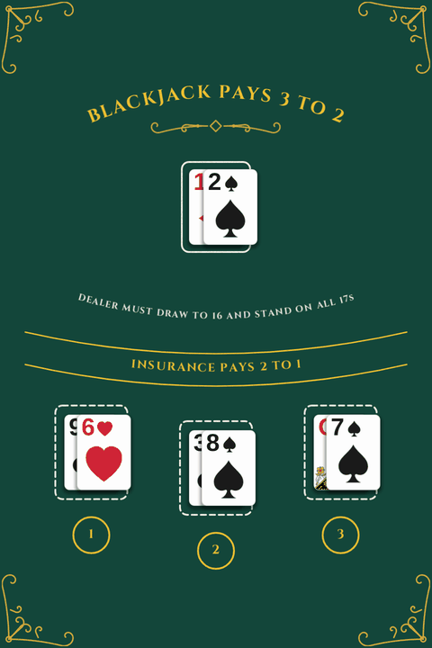
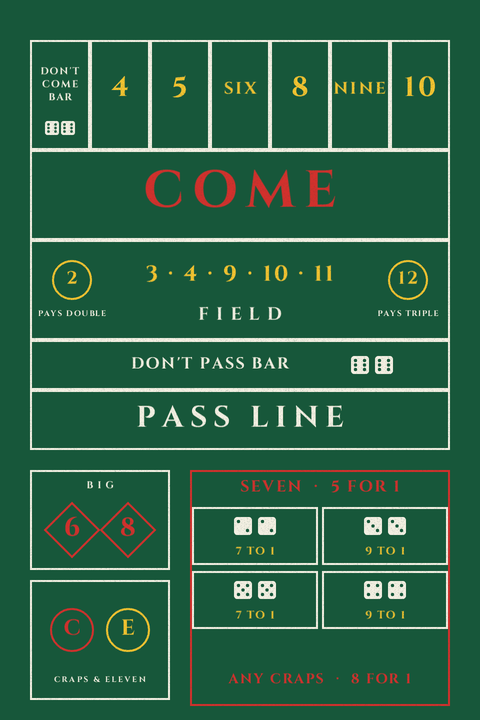
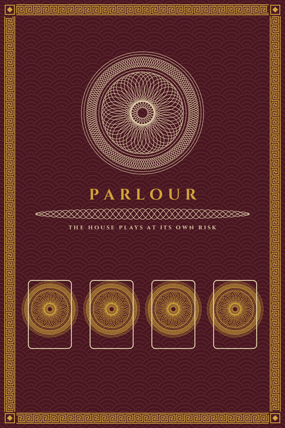
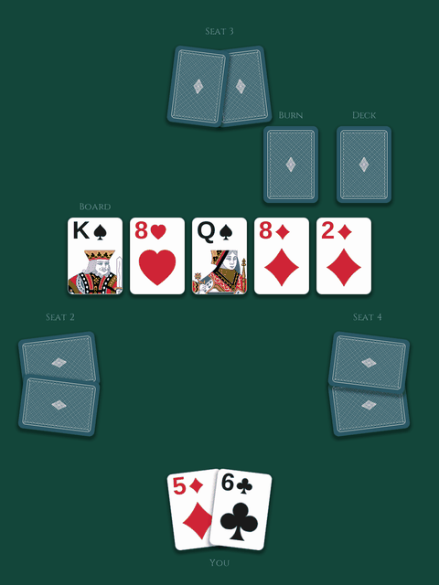
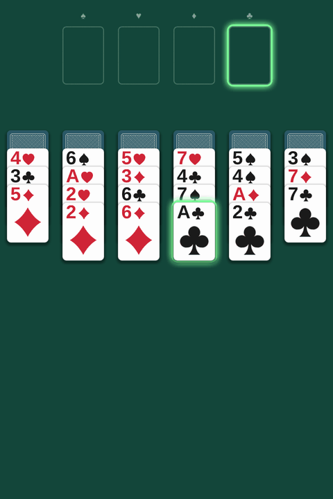
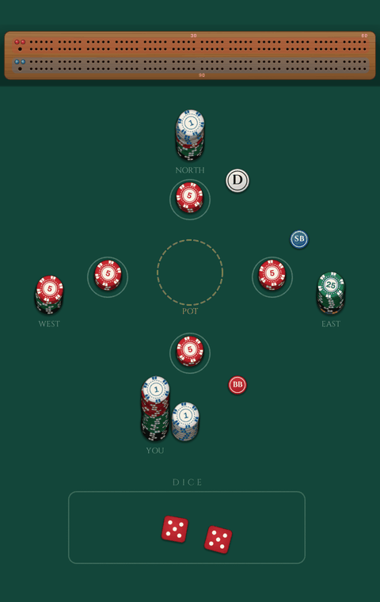
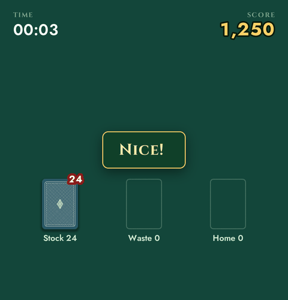
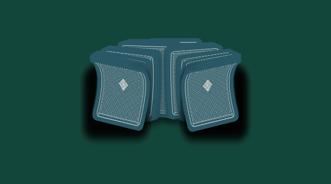
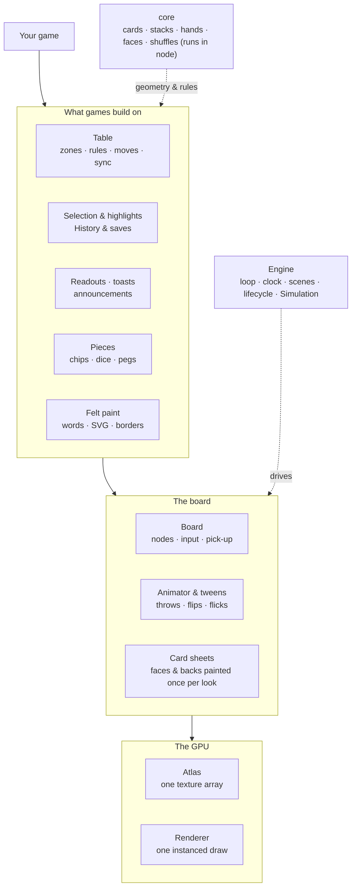
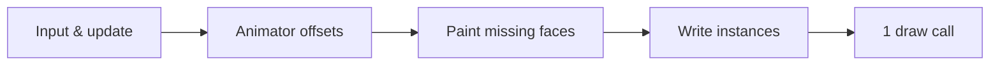

# felt

**A WebGL2 engine for card games, and nothing else.**

Every card on the table is one instance of one draw call. Cards lift, tip,
bend and fly in real perspective, and a table nothing is moving on draws
nothing at all. It is 21 kB gzipped, with no dependencies.

**[Play with the demos →](https://exterkamp.github.io/felt/)**

<table>
  <tr>
    <td></td>
    <td></td>
    <td></td>
    <td></td>
  </tr>
  <tr>
    <td></td>
    <td></td>
    <td></td>
    <td></td>
  </tr>
</table>

## What you get

- **Cards that feel physical.** You can throw, flick, flip, riffle and fan
  them. A dragged card lifts and leans into the pull.
- **A table to build games on.** Zones own their cards and rules decide what
  can move where. Drag, flick and tap-to-move all ask those rules, and
  `sync` shows a game state that lives anywhere.
- **Game plumbing.** Undo and redo, saves that resume on reload,
  selection and hints, and readouts, toasts and screen-reader announcements.
- **More than cards.** Chips that make change, a dealer button, seeded dice
  and a cribbage peg board.
- **Paint for the felt.** Lettering, outlines, SVG art and nine classic
  borders, enough for blackjack, baccarat and craps layouts.
- **A real engine.** One loop, scenes, the page lifecycle, lost-context
  recovery, and a deterministic simulation for lockstep multiplayer.

## Fast

Measured by the bench (`demo/bench.html`) against
[phaser-card-engine](https://github.com/exterkamp/phaser-card-engine), on the
same table with every card moving every frame:

| 2080 cards | felt | phaser-card-engine |
| --- | ---: | ---: |
| JavaScript a frame | **1.5 ms** | 60 ms |
| Making the cards | **62 ms** | 2330 ms |
| Memory | **11 MB** | 54 MB |

## How it fits together



Each frame, the input and the game's update move cards and the Animator adds
its offsets. Any card face not painted yet is painted into the atlas. Every
card then becomes 32 floats in one instance buffer, and one draw call puts
the table on screen.



## Quick start

```ts
import { createBoard, createTable, shuffledDeck } from 'felt';

const board = createBoard({ parent: 'board', width: 480, height: 640, backgroundColor: '#13463a' });
const table = createTable(board);
const deck = table.pile({ id: 'deck', x: 240, y: 120, faceUp: false });
const hand = table.hand({ id: 'hand', x: 240, y: 560, faceUp: true });

deck.put(shuffledDeck());
await table.deal(deck, [hand], { rounds: 5 });
table.draggable();
```

```bash
npm install && npm run demo    # the demos at localhost:4390
npm test                       # typecheck and 440 specs
```

**[The guide](docs/guide.md)** covers each part in depth.
[`docs/runtime.md`](docs/runtime.md) explains how the engine was designed.

## Licence

CC0. The court art is Dmitry Fomin's CC0 English pattern, and the fonts are
OFL and Apache-2.0; see [`ATTRIBUTION.md`](ATTRIBUTION.md).
